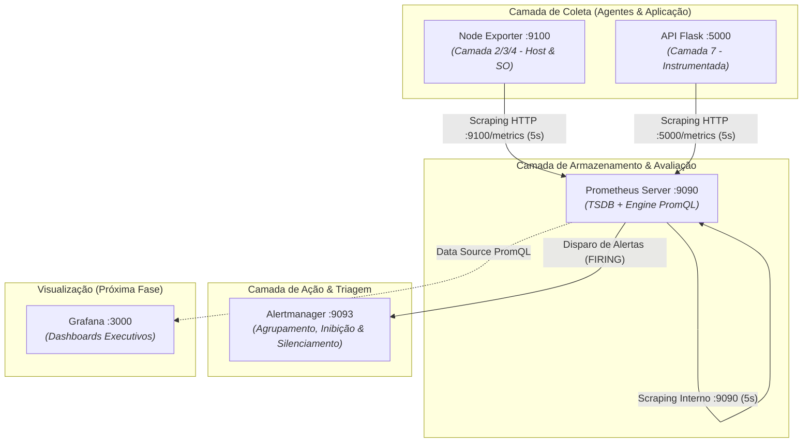

# 📡 Laboratório de Observabilidade e Gerência de Redes
> **Ambiente prático com Prometheus, Node Exporter, Alertmanager e API Flask em Docker**  
> *Projeto desenvolvido para o seminário da disciplina de Segurança e Gerência de Redes.*

---

## 🎯 Objetivo do Projeto
Demonstrar na prática os fundamentos modernos de **Observabilidade e Gestão de Incidentes** em infraestruturas de redes e microsserviços. 

O laboratório implementa o modelo **Pull (Scraping)** do Prometheus para inspecionar desde as camadas de infraestrutura/enlace (SO, tráfego de interface, drops de pacotes) até a camada de aplicação (L7 HTTP, latência, taxas de erro), integrando com o **Alertmanager** para controle de *flapping*, agrupamento de alarmes e silenciamento em janelas de manutenção.

---

## 🏗️ Arquitetura do Ambiente



---

## ⚙️ Pré-requisitos
Para executar o laboratório em qualquer sistema operacional (Linux, WSL2, macOS ou Windows):
- **Docker Engine** (>= 20.10)
- **Docker Compose** (>= 2.0)
- Utilitário de linha de comando `curl` (para testes de rotas e injeção de falhas)

---

## 🚀 Como Executar

1. **Clone o repositório:**
   ```bash
   git clone <URL_DO_SEU_REPOSITORIO>
   cd seminario-prometheus-grafana
   ```

2. **Inicie os serviços em segundo plano:**
   ```bash
   docker compose up -d
   ```

3. **Verifique se todos os contêineres estão saudáveis:**
   ```bash
   docker compose ps
   ```

---

## 🌐 Endpoints e Portas do Laboratório

| Serviço | Porta | Descrição / Acesso |
| :--- | :---: | :--- |
| **API Monitorada (Flask)** | `:5000` | `http://localhost:5000/` (Gera métricas em `/metrics`) |
| **Node Exporter** | `:9100` | `http://localhost:9100/metrics` (Telemetria do Host/Rede) |
| **Prometheus Server** | `:9090` | `http://localhost:9090` (TSDB, Consultas PromQL e Targets) |
| **Alertmanager** | `:9093` | `http://localhost:9093` (Painel NOC de Gestão de Alertas) |

---

## 🎯 Targets Analisados no Prometheus
No painel do Prometheus (`http://localhost:9090/targets`), três alvos são monitorados continuamente a cada **5 segundos**:

1. **`aplicacao-monitorada` (`app:5000`)**:
   - Mede requisições L7 via `http_requests_total` com rótulos `method`, `endpoint` e `status`.
   - Mede tempo de resposta com o histograma `http_request_duration_seconds`.
2. **`sistema-operacional` (`node-exporter:9100`)**:
   - Mede tráfego de rede das interfaces físicas/virtuais (`node_network_receive_bytes_total`, `node_network_transmit_bytes_total`).
   - Mede falhas de rede (`node_network_receive_errs_total`) e descarte de frames/drops (`node_network_receive_drop_total`).
   - Telemetria de CPU, memória RAM e I/O de disco.
3. **`auto-monitoramento-prometheus` (`localhost:9090`)**:
   - Métricas de integridade do próprio banco temporal (taxa de ingestão de amostras, chunks de memória e latência de scraping).

---

## 🚨 Regras de Alerta Ativas (`alert_rules.yml`)

As regras são avaliadas a cada **5 segundos** pelo Prometheus e disparadas para o Alertmanager:

| Nome do Alerta | Severidade | Condição PromQL | Carência (`for`) | Objetivo |
| :--- | :---: | :--- | :---: | :--- |
| **`Aplicacao-Indisponivel`** | `critical` | `up{job="aplicacao-monitorada"} == 0` | 10s | Detecta queda total do contêiner da aplicação ou falha de conexão na porta 5000. |
| **`Sistema-Operacional-Indisponivel`** | `critical` | `up{job="sistema-operacional"} == 0` | 10s | Detecta perda de conectividade com o agente Node Exporter (possível falha de host/máquina). |
| **`Alta-Taxa-Erros-5xx`** | `warning` | `rate(http_requests_total{... status="500"}[30s]) > 0` | 5s | Detecta anomalias e falhas de software internas na Camada 7. |

---

## 🧪 Roteiro de Testes e Simulação de Incidentes

### 1. Teste de Operação Normal (Tráfego Saudável)
```bash
# Requisição HTTP 200 regular
curl http://localhost:5000/

# Inspecionar as métricas registradas em tempo de execução
curl -s http://localhost:5000/metrics | grep http_requests_total
```

### 2. Simulação de Anomalia L7 (Pico de Erros HTTP 500)
Dispare uma rajada de requisições de falha no endpoint `/erro`:
```bash
for i in {1..20}; do curl -s http://localhost:5000/erro > /dev/null; sleep 0.2; done
```
* **O que observar:** Acesse `http://localhost:9090/alerts`. O alerta `Alta-Taxa-Erros-5xx` mudará para amarelo (**PENDING**) e, após 5 segundos, para vermelho (**FIRING**), sendo enviado para o Alertmanager (`http://localhost:9093`).

### 3. Simulação de Queda de Serviço (Target DOWN)
Pare o contêiner da aplicação:
```bash
docker compose stop app
```
* **O que observar:**
  1. Em `http://localhost:9090/targets`, o endpoint `aplicacao-monitorada` fica **`DOWN`**.
  2. Em `http://localhost:9090/alerts`, `Aplicacao-Indisponivel` entra em **PENDING** e após 10s em **FIRING**.
  3. No Alertmanager (`http://localhost:9093`), o card de incidente crítico aparece categorizado.
  4. **Teste de NOC (Silenciamento):** Clique em **Silence** no Alertmanager para demonstrar o controle de janelas de manutenção.

### 4. Auto-Recuperação
Suba a aplicação novamente:
```bash
docker compose start app
```
* O Prometheus detecta o retorno em 5 segundos, o target volta para **`UP`** e o alarme é resolvido automaticamente sem necessidade de limpeza manual.

---

## 📊 Status do Projeto e Próximos Passos

- [x] **Etapa 1:** Construção e instrumentação da API Flask com contadores e histogramas (`prometheus-client`).
- [x] **Etapa 2:** Configuração do coletor central Prometheus e agente Node Exporter para scraping do SO e rede.
- [x] **Etapa 3:** Criação de queries PromQL e elaboração do catálogo de regras de alerta (`alert_rules.yml`).
- [x] **Etapa 4:** Integração completa com Alertmanager (`alertmanager.yml`) para triagem, desduplicação e silenciamento.
- [ ] **Etapa 5:** Implementação dos Dashboards no Grafana e injeção de carga contínua com `load-generator` *(Próxima Sessão)*.
