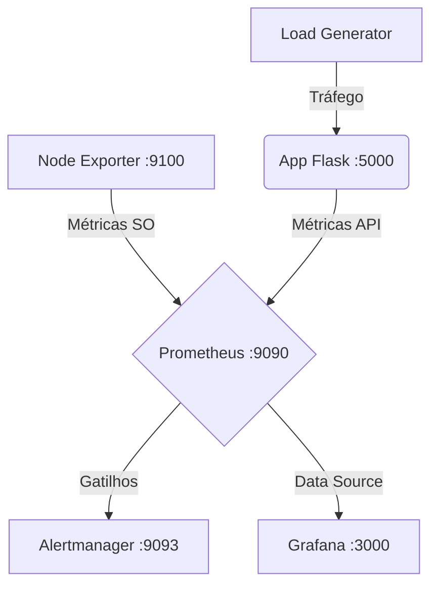

# Laboratório de Monitoramento: Prometheus & Grafana

Este repositório contém a infraestrutura prática para o seminário da disciplina de [[Segurança e Gerência de Redes]]. O ambiente é totalmente orquestrado via Docker e focado na coleta e visualização de métricas, simulando o monitoramento da máquina host e de uma API em Python.

## Arquitetura do Ambiente



## Como Executar

O ambiente é multiplataforma e pode ser executado em qualquer sistema com o daemon do Docker ativo.

1. Clone este repositório:
   ```bash
   git clone [https://github.com/SEU_USUARIO/SEU_REPOSITORIO.git](https://github.com/SEU_USUARIO/SEU_REPOSITORIO.git)
   cd SEU_REPOSITORIO
   ```
2. Suba os containers em segundo plano:
   ```bash
   docker compose up -d
   ```

## Acessos Locais

Após a inicialização, os serviços estarão disponíveis nas seguintes portas:

- **Aplicação (API):** http://localhost:5000 (Gera métricas em `/metrics`)
- **Prometheus:** http://localhost:9090 (Consultas PromQL e visualização de Targets/Alerts)
- **Alertmanager:** http://localhost:9093 (Central de despacho de alertas)
- **Grafana:** http://localhost:3000 (Painéis de visualização. Credenciais padrão: `admin` / `admin`)

## Testando Alertas

O laboratório possui regras de alerta configuradas no arquivo `alert_rules.yml`.

- **Queda de Serviço:** Pare o container da aplicação com `docker stop <nome_do_container_app>` para disparar o alerta de indisponibilidade de target.
- **Pico de Erros:** Acesse a rota http://localhost:5000/erro repetidas vezes (ou use um laço de repetição no terminal) para forçar uma taxa de falha HTTP 500 acima do limite tolerado pela query PromQL.
