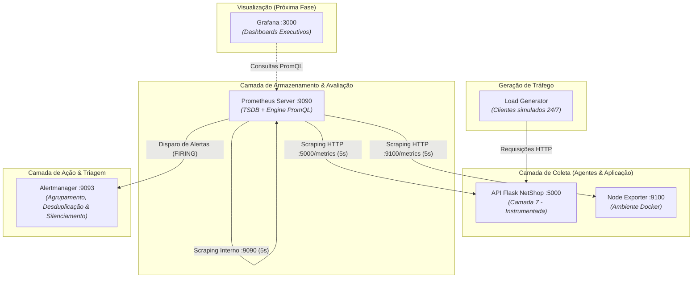

# 📡 Laboratório de Observabilidade e Gerência de Redes
> **Ambiente prático com Prometheus, Node Exporter, Alertmanager e API Flask em Docker**  
> *Projeto desenvolvido para o seminário da disciplina de Segurança e Gerência de Redes.*

---

## 🎯 Objetivo do Projeto
Demonstrar na prática os fundamentos modernos de **Observabilidade e Gestão de Incidentes** em infraestruturas de redes e microsserviços. 

O laboratório implementa o modelo **Pull (Scraping)** do Prometheus para inspecionar desde o ambiente Docker (SO, CPU, memória, tráfego de interface, drops de pacotes) até a camada de aplicação (L7 HTTP, latência, taxas de erro) da loja fictícia **NetShop**. A carência (`for`) das regras do Prometheus evita alarmes por condições passageiras, e o **Alertmanager** faz o agrupamento, a desduplicação e o silenciamento em janelas de manutenção.

---

## 🏗️ Arquitetura do Ambiente

As setas de scraping partem do Prometheus porque é ele quem inicia cada coleta (modelo Pull).



---

## ⚙️ Pré-requisitos
Para executar o laboratório em qualquer sistema operacional (Linux, WSL2, macOS ou Windows):
- **Docker Engine** (>= 20.10)
- **Docker Compose** (>= 2.0)
- **Python 3** (para o painel interativo `painel_seminario.py`)
- Terminal **Bash** com `curl` e `grep` (para os comandos manuais do roteiro de testes; no Windows, use Git Bash ou WSL2)

---

## 🚀 Como Executar

1. **Clone o repositório:**
   ```bash
   git clone <URL_DO_SEU_REPOSITORIO>
   cd seminario-prometheus-grafana
   ```

2. **Inicie os serviços em segundo plano:**
   ```bash
   docker compose up -d
   ```

3. **Verifique se todos os contêineres estão em execução:**
   ```bash
   docker compose ps
   ```

---

## 🌐 Endpoints e Portas do Laboratório

| Serviço | Porta | Descrição / Acesso |
| :--- | :---: | :--- |
| **API Monitorada (Flask)** | `:5000` | `http://localhost:5000/` (Gera métricas em `/metrics`) |
| **Node Exporter** | `:9100` | `http://localhost:9100/metrics` (Telemetria do ambiente Docker) |
| **Prometheus Server** | `:9090` | `http://localhost:9090` (TSDB, Consultas PromQL e Targets) |
| **Alertmanager** | `:9093` | `http://localhost:9093` (Painel NOC de Gestão de Alertas; nenhuma notificação externa configurada) |
| **Load Generator** | — | Sem porta publicada; acessa a API pela rede interna do Docker |

### Rotas da API

| Rota | Método | Função |
| :--- | :---: | :--- |
| `/` | `GET` | Status da API e estado atual do modo de caos |
| `/produtos` | `GET` | Catálogo de produtos (tráfego normal) |
| `/login` | `POST` | Autenticação; senha inválida retorna HTTP 401 |
| `/checkout` | `POST` | Finalização de compra; sujeita à latência e à falha de gateway (HTTP 504) injetadas |
| `/admin/caos` | `GET`, `POST` | Consulta ou altera `latencia_checkout_seg` e `falha_gateway` |
| `/metrics` | `GET` | Métricas coletadas pelo Prometheus |

---

## 🎯 Targets Analisados no Prometheus
No painel do Prometheus (`http://localhost:9090/targets`), três alvos são monitorados continuamente a cada **5 segundos**:

1. **`aplicacao-monitorada` (`app:5000`)**:
   - Mede requisições L7 via `http_requests_total` com rótulos `method`, `endpoint` e `status`.
   - Mede tempo de resposta com o histograma `http_request_duration_seconds`.
   - Mede requisições simultâneas com o gauge `http_requests_in_progress`.
   - Mede tentativas de compra com `netshop_vendas_total`, com o rótulo `resultado`.
2. **`sistema-operacional` (`node-exporter:9100`)**:
   - Monitora o ambiente Docker, e não o sistema operacional da máquina física (por exemplo, o Windows).
   - Telemetria de CPU, memória RAM e I/O de disco do kernel Linux que executa os contêineres.
   - Mede o tráfego de rede da interface do contêiner do Node Exporter (`node_network_receive_bytes_total`, `node_network_transmit_bytes_total`).
   - Mede falhas (`node_network_receive_errs_total`) e descartes (`node_network_receive_drop_total`) nessa mesma interface.
3. **`auto-monitoramento-prometheus` (`localhost:9090`)**:
   - Métricas de integridade do próprio banco temporal (taxa de ingestão de amostras, chunks de memória e latência de scraping).

---

## 🚨 Regras de Alerta Ativas (`alert_rules.yml`)

As regras são avaliadas a cada **5 segundos** pelo Prometheus e disparadas para o Alertmanager:

| Nome do Alerta | Severidade | Condição PromQL | Carência (`for`) | Objetivo |
| :--- | :---: | :--- | :---: | :--- |
| **`Aplicacao-Indisponivel`** | `critical` | `up{job="aplicacao-monitorada"} == 0` | 10s | Detecta queda total do contêiner da aplicação ou falha de conexão na porta 5000. |
| **`Sistema-Operacional-Indisponivel`** | `critical` | `up{job="sistema-operacional"} == 0` | 10s | Detecta perda de conectividade com o agente Node Exporter. |
| **`Suspeita-Ataque-BruteForce`** | `critical` | `rate(http_requests_total{... endpoint="/login", status="401"}[30s]) > 0.5` | 5s | Detecta taxa elevada de falhas de autenticação na rota `/login`. |
| **`Latencia-Critica-Checkout`** | `warning` | `histogram_quantile(0.95, sum by (le) (rate(http_request_duration_seconds_bucket{... endpoint="/checkout"}[30s]))) > 1.0` | 5s | Detecta latência p95 do checkout acima de 1 segundo. |
| **`Falha-Gateway-Pagamento`** | `critical` | `rate(http_requests_total{... status=~"5.."}[30s]) > 0` | 5s | Detecta erros HTTP 5xx, como o 504 da falha no gateway de pagamento. |

---

## 🧪 Roteiro de Testes e Simulação de Incidentes

O `load-generator` envia tráfego continuamente, inclusive para o `/checkout`, então os cenários de caos não precisam de requisições manuais nessa rota.

### Painel interativo
O painel automatiza os cenários de vendas, erros 5xx, queda e restauração. Execute-o na raiz do repositório:
```bash
python painel_seminario.py
```

Os cenários de brute-force e latência não estão no painel e são executados apenas pelos comandos abaixo.

### 1. Teste de Operação Normal (Tráfego Saudável)
```bash
# Requisição HTTP 200 regular
curl http://localhost:5000/

# Inspecionar as métricas registradas em tempo de execução
curl -s http://localhost:5000/metrics | grep http_requests_total
```

### 2. Simulação de Falha no Gateway de Pagamento (HTTP 504)
Ative a falha:
```bash
curl -X POST http://localhost:5000/admin/caos -d '{"falha_gateway": true}'
```
* **O que observar:** Acesse `http://localhost:9090/alerts`. O alerta `Falha-Gateway-Pagamento` mudará para amarelo (**PENDING**) e, após 5 segundos, para vermelho (**FIRING**), sendo enviado para o Alertmanager (`http://localhost:9093`).

Desative a falha:
```bash
curl -X POST http://localhost:5000/admin/caos -d '{"falha_gateway": false}'
```

### 3. Simulação de Degradação de Latência (QoS/SLA)
Adicione 1,5 segundo de atraso ao checkout:
```bash
curl -X POST http://localhost:5000/admin/caos -d '{"latencia_checkout_seg": 1.5}'
```
* **O que observar:** Em `http://localhost:9090/alerts`, o alerta `Latencia-Critica-Checkout` entra em **PENDING** e depois em **FIRING**.

Remova o atraso:
```bash
curl -X POST http://localhost:5000/admin/caos -d '{"latencia_checkout_seg": 0}'
```

### 4. Simulação de Ataque de Brute-Force (HTTP 401)
Dispare uma rajada de tentativas com senha inválida:
```bash
for i in {1..60}; do curl -s -o /dev/null -X POST http://localhost:5000/login -d '{"usuario":"cliente","senha":"errada"}'; sleep 0.2; done
```
* **O que observar:** Em `http://localhost:9090/alerts`, o alerta `Suspeita-Ataque-BruteForce` entra em **PENDING** e depois em **FIRING**.

### 5. Simulação de Queda de Serviço (Target DOWN)
Pare o contêiner da aplicação:
```bash
docker compose stop app
```
* **O que observar:**
  1. Em `http://localhost:9090/targets`, o endpoint `aplicacao-monitorada` fica **`DOWN`**.
  2. Em `http://localhost:9090/alerts`, `Aplicacao-Indisponivel` entra em **PENDING** e após 10s em **FIRING**.
  3. No Alertmanager (`http://localhost:9093`), o card de incidente crítico aparece categorizado.
  4. **Teste de NOC (Silenciamento):** Clique em **Silence** no Alertmanager para demonstrar o controle de janelas de manutenção.

### 6. Auto-Recuperação
Suba a aplicação novamente:
```bash
docker compose start app
```
* O Prometheus detecta o retorno em até 5 segundos, o target volta para **`UP`** e o alarme é resolvido automaticamente sem necessidade de limpeza manual.

---

## 📊 Status do Projeto e Próximos Passos

- [x] **Etapa 1:** Construção e instrumentação da API Flask com contadores, histogramas e gauge (`prometheus-client`).
- [x] **Etapa 2:** Configuração do coletor central Prometheus e agente Node Exporter para scraping do ambiente Docker.
- [x] **Etapa 3:** Criação de queries PromQL e elaboração do catálogo de regras de alerta (`alert_rules.yml`).
- [x] **Etapa 4:** Integração completa com Alertmanager (`alertmanager.yml`) para triagem, desduplicação e silenciamento.
- [x] **Etapa 5:** Injeção de carga contínua com `load-generator`, controles de caos na API e painel interativo do seminário.
- [ ] **Etapa 6:** Implementação dos Dashboards no Grafana *(Próxima Sessão)*.
